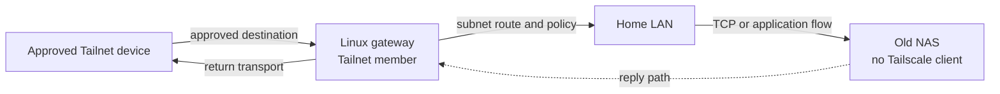

**English** · [简体中文](60-travel-router.zh-CN.md)

# Carry a travel router, or put a client on every device?

You arrive at a short-stay apartment for the weekend. A phone, a laptop, and an
old printer can all join the Wi-Fi, but not every device is a good place to
install another client. At home there is a similar scene: an old NAS or storage
box still does its job, yet cannot run a modern VPN client. Before assuming
that every device needs its own client, ask which device can hold a stable
network identity and which devices only need to be reached through it.

A travel router is one answer. It can combine the upstream connection, Wi-Fi,
and Tailnet membership in one manageable box while a television, printer, or
old computer keeps using ordinary networking. That reduces client installation
on endpoints, but it does not automatically give every device the full Tailnet
or create a security policy. `ROUTE-01` `CLAIM-01`

This article discusses an architecture, not a firmware recipe for a particular
router. In the Mintie reference, the router owns transparent routing and DNS
policy. Do not assume Mintie runs any particular firmware, or that every
travel router has equivalent Tailscale integration.

## Start with three concrete scenes

**One: only one device in a hotel can complete the guest-network login.** A
travel router joins the hotel Wi-Fi and shares connectivity with a tablet and a
television. If it is only an ordinary hotspot, those devices have Internet
access; they do not thereby appear in your Tailnet.

**Two: the NAS at home has no client.** A Linux host or router that can run
Tailscale joins the Tailnet and acts as a gateway to the NAS's local area
network (LAN). A Tailnet device selects that subnet route, then uses policy to
reach the NAS. The NAS does not need to understand Tailscale.

**Three: from outside, a device that cannot install a client needs a home
service.** This is more than connecting from the Tailnet to a NAS. The remote
device also needs an approved local routing owner that sends its destination
traffic to the Tailnet gateway. Wi-Fi alone does not create that path, and DNS
and firewalls have to agree with it.

## Client-free does not mean policy-free

A typical data path looks like this:

Two directions are easy to confuse. A gateway advertises a Tailnet-to-home-LAN
subnet route. A device behind that LAN does not need its own Tailscale client
when replies can return to the gateway. In the other direction, a LAN device
that actively initiates access to a remote service still needs either a
managed path through the router or another routing owner. Hiding a device
behind a router does not change its route by itself.

When a travel router acts as a home subnet router, it has two jobs: join the
Tailnet and leave the intended LAN prefix with the gateway. Do not advertise
the whole home network, the hotel's current network, and every private address
together. Broad advertisements make it harder to explain which caller reaches
which site. Tailscale's
[subnet router documentation](https://tailscale.com/docs/features/subnet-routers)
keeps these gateways distinct from exit nodes: a subnet route reaches a network,
while an exit node changes the general Internet exit. They are not one switch.

Subnet routers use SNAT by default. For ordinary access to a destination LAN,
the NAS usually sees the gateway's identity rather than the remote Tailnet
device's source. Only a deliberately source-preserving Linux gateway, with SNAT
disabled, needs a route on LAN devices pointing replies back to that gateway.
**That return route is a requirement of the source-preserving arrangement, not
an extra step that default SNAT also needs.**

## Establish five prerequisites before building

1. **The network identity has a home.** The travel router or home gateway can
   remain signed in to the Tailnet, and someone owns key expiry, revocation,
   and recovery after a restart. Without that, "always online" is merely an old
   observation.
2. **Each hop has an explicit routing owner.** Different devices can own
   different hops. Avoid competing default-route, DNS, or interception managers
   on the same host, namespace, or traffic scope; define their coexistence
   boundary first. `ROUTE-01`
3. **The subnet prefix identifies the intended destination.** Tailnet policy
   must agree about which gateway may advertise which subnet route. Overlapping
   site addresses are not solved by whichever match happens to arrive first.
4. **DNS and URL identity remain intact.** A device without a client may still
   need a name for the home service. If an application depends on a canonical
   HTTPS hostname, retain that hostname and place resolution and certificate
   validation where the design actually provides them.
5. **Return paths and authorization both work.** Default SNAT and a
   source-preserving gateway have different return requirements. In either
   case, subnet reachability cannot replace the Tailnet ACL/Grants or the NAS's
   own login policy.

These are reference-architecture conditions; they do not show that a particular
travel-router firmware satisfies all of them. On 2026-10-22, GL.iNet still
labels its [Tailscale integration](https://docs.gl-inet.com/router/en/4/interface_guide/tailscale/)
as beta and names specific models. Its version 4.9 IP Masquerading, exit-node,
and subnet-renaming changes require separate review. A switch in a UI does not
prove compatibility with Mintie's existing transparent-routing owner.

## Distinguish which assumption failed

**The device is online in Tailnet management, but the NAS times out.** That
proves control-plane membership only. Check whether the gateway really
advertises the intended subnet, whether the requesting peer accepted that
route, whether LAN admission permits the flow, and whether the NAS's replies
return to the gateway. "Online" alone is not path evidence.

**The travel router reaches the Internet, but the television cannot see home.**
Its Internet uplink and its role as a Tailnet gateway are separate jobs. Check
whether the television's destination is deliberately routed through the travel
router and whether that router has a path to the home service.

**The office and home both use the same private IPv4 range.** A bare subnet
route may look like it points to one network while it actually describes two
sites. Tailscale's
[4via6 subnet documentation](https://tailscale.com/docs/features/subnet-routers/4via6-subnets)
uses an IPv6 mapping with a site identity; it does not renumber the original
IPv4 devices. See [case 6](50-worked-cases.en.md#4via6-site-identity) for site
identity and repeated routers.

**An outbound packet reaches the NAS, but its reply never returns.** Even the
TCP handshake may be incomplete; this does not establish an HTTPS or application
request. For a source-preserving gateway, check for a LAN return route, then
the declared site and prefix. Do not apply that check blindly to an ordinary
default-SNAT subnet path.

These observations narrow the problem. They do not prove DNS, TLS, application
authorization, or the health of a particular device. `UNKNOWN` remains a valid
path conclusion.

## Its boundary, and when it is not worth it

A travel router is useful for reducing client installation on fixed devices and
concentrating network identity somewhere manageable. It is not an authorization
bypass: a peer relay, subnet route, or Tailnet membership is transport and
reachability, not a replacement for a Tailnet grant, NAS login, or application
permission.

If one phone occasionally uses one service, running Tailscale directly on that
device may be simpler. If the router vendor's integration is still beta, or a
Mintie already owns interception, DNS, and fail-closed enforcement, adding a
second routing/DNS owner for the same traffic scope may cost more than it saves. Tailscale's
[VPN coexistence guide](https://tailscale.com/docs/reference/faq/other-vpns)
explains mobile active-VPN conflicts and other limits on combining network
tools.

Finally, a clear diagram proves only that the architecture can be described. A
real deployment still needs separate installed, activated, and path evidence.
This page does not claim a live test of any travel router, NAS, Tailnet, or home
network.

Continue reading:

- [Let the VPS join the Tailnet, so the phone switches VPNs less](40-tailnet-vps-private-ingress.en.md)
  covers dedicated ingress, the canonical HTTPS origin, and authorization
  boundaries.
- [What can a peer relay do when direct transport is blocked?](70-peer-relay.en.md)
  separates transport from an Internet exit.
- [Cloudflare Mesh, Tailscale, and the OpenWrt boundary](80-mesh-and-openwrt.en.md)
  compares peer mesh, Tunnel, and router integration by layer.
- Read [Infra Field Guide: network and proxies](https://github.com/IndelibleVivi/infra-field-guide/blob/main/docs/07-network-and-proxies.md)
  and [private access](https://github.com/IndelibleVivi/infra-field-guide/blob/main/docs/09-private-access.md)
  for broader background.
