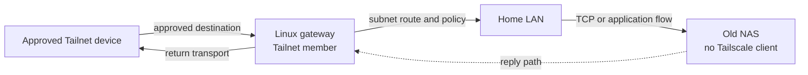

[English](60-travel-router.en.md) · **简体中文**

# 带一台旅行路由器，还是给每台设备装客户端？

周末住进一间临时公寓。手机、电脑和一台老打印机都能连 Wi-Fi，却不一定都愿意
安装新的客户端。另一个常见画面在家里：一台旧 NAS 或存储盒工作正常，但它跑不了
如今的 VPN 客户端。与其把“每台设备都自己接入”当作前提，可以先问：哪台设备
能稳定地承担网络身份，哪些设备只需要通过它转发？

旅行路由器是前者的一种选择。它把上行连接、Wi-Fi 和 Tailnet 成员身份收在一个
可带走的小盒子里，后面的电视、打印机或旧电脑继续用普通网络。这个做法能减少
终端客户端，但不会自动让所有设备获得完整 Tailnet，更不会自动给出安全策略。
`ROUTE-01` `CLAIM-01`

这里讨论的是一类架构，不是某款旅行路由器的安装说明。Mintie 的 reference 仍由
路由器承担透明 routing 与 DNS policy；本文不假设 Mintie 已经运行某版固件，也不
假设任意旅行路由器都有相同的 Tailscale 集成。

## 先看三个很具体的场景

**场景一：旅馆里只有一台设备能完成网络登录。** 旅行路由器先连接旅馆 Wi-Fi，
再把网络分给平板和电视。若它只是普通热点，设备获得的是互联网，不会因此出现在
你的 Tailnet 中。

**场景二：家里的旧 NAS 不装客户端。** 家中一台能运行 Tailscale 的 Linux 主机或
路由器加入 Tailnet，并作为通往 NAS 所在局域网（LAN）的 gateway。Tailnet 里的
设备选择这条 subnet route 后，才能按策略访问 NAS。NAS 本身不必理解 Tailscale。

**场景三：你在外面想让一台不能装客户端的设备访问家里。** 这比“从 Tailnet
访问 NAS”多一层：那台设备还要有一个获准的本地 routing owner，把它的目的地流量
交给 Tailnet gateway。仅有 Wi-Fi 不足以产生这条路径，DNS 和 firewall 也必须
配合。

## Client-free 不等于 policy-free

一个典型的数据路径可以写成：

这里有两个容易混淆的方向。Tailnet 到家庭 LAN 的 subnet route，由 gateway 宣告；
家庭里那台不装客户端的设备，只要 return traffic 能回到 gateway，就能参与连接。
反过来，LAN 内的设备要通过 Tailnet 主动访问远端服务，还得让该设备或另一个受管
routing owner 选择这条路径。把一台设备“藏在 router 后面”不会凭空改变它的路由。

如果旅行路由器在家里充当 subnet router，它也有两条工作：加入 Tailnet，以及把
目标 LAN prefix 留给 gateway。不要把整个家庭网络、你当前所在的旅馆网络和所有
私有地址一起宣告；范围越宽，越难解释谁会到达哪里。Tailscale 的
[subnet router 文档](https://tailscale.com/docs/features/subnet-routers)
把这种 gateway 与 exit node 分开：subnet route 是去某个网络，exit node 是
改变一般互联网出口。两者不是同一个开关。

subnet router 默认使用 SNAT。以 destination LAN 的普通访问为目标时，NAS 看到的
来源通常是 gateway，而不是远端 Tailnet 设备。只有特意采用 source-preserving
（关闭 SNAT）的 Linux gateway，才需要为 LAN 设备准备返回 gateway 的 route。
这是常见误解的来源：**return route 是 source-preserving 的前提，不是默认 SNAT
也必须完成的步骤。**

## 动手前，先证明五个前提

1. **网络身份有归宿。** 旅行路由器或家庭 gateway 能持续登录 Tailnet，并有人
   管理 key 过期、撤销和重启后的恢复。否则“设备永远在线”只是上一次观察。
2. **每一跳的 routing ownership 都明确。** 不同设备可以各自负责一跳；需要避免
   的是同一 host、namespace 或流量范围内，多个工具争抢默认路由、DNS 或
   packet interception。先写清楚共存边界。`ROUTE-01`
3. **subnet prefix 与目的地对应。** Tailnet policy 允许哪台 gateway 宣告哪条
   subnet route，必须与实际 LAN 相符。重叠地址不能用“碰巧第一个匹配”解决。
4. **DNS 与 URL 的身份不受损。** 不装客户端不代表不需要解析 home service 的
   名字。若应用依赖 canonical HTTPS hostname，继续保留该 hostname，并把解析与
   证书验证放在已设计好的位置。
5. **return path 与授权都成立。** 默认 SNAT 与 source-preserving gateway 的
   return 要求不同；无论哪一种，Tailnet ACL/Grants 和 NAS 自己的登录权限都不能
   被 subnet reachability 替代。

这些条件来自 reference architecture，不代表某个旅行路由器固件已经满足全部条件。
GL.iNet 的 [Tailscale 集成文档](https://docs.gl-inet.com/router/en/4/interface_guide/tailscale/)
在 2026-10-22 仍标注为 beta，并列出具体型号；其 4.9 的 IP Masquerading、exit
node 与 subnet 名称也需要单独核对。看见 UI 里有开关，不等于它与 Mintie 的现有
transparent-routing owner 兼容。

## 怎样看出错的是哪一个假设

**Tailnet 管理页显示设备在线，但 NAS 仍然超时。** 这只证明控制面的成员状态。
继续区分：gateway 是否真的宣告了目标 subnet，发出请求的 peer 是否接受了这条
route，LAN admission 是否放行，NAS 的 return traffic 是否回到 gateway。单一
“在线”不能替代 path evidence。

**旅行路由器能上网，后面的电视却看不到家里。** 旅行路由器作为互联网 uplink
与作为 Tailnet gateway 是两件事。检查电视的目的地是否真的交给旅行路由器，以及
该路由器是否配置了通向 home service 的 Tailnet route。

**办公室和家里都使用同一个 IPv4 私网范围。** 裸 subnet route 看起来指向“同一个
网络”，实际却可能是两个不同 site。Tailscale 的
[4via6 subnet 文档](https://tailscale.com/docs/features/subnet-routers/4via6-subnets)
为此使用带 site 身份的 IPv6 mapping；它不重编号原来的 IPv4 设备。如何使用 site
身份与重复 router，见[案例 6](50-worked-cases.zh-CN.md#4via6-site-identity)。

**去程包到了 NAS，回复却没回来。** 这可能连 TCP handshake 都未完成，不能
据此说 HTTPS 或应用请求已成功。对 source-preserving gateway，先检查 LAN
设备是否有指向 gateway 的 return route；再检查 gateway 是否声明了正确 site 与
prefix。默认 SNAT 的普通 subnet 路径不应被这段检查误导。

这些观察可以缩小问题范围；它们不自动证明 DNS、TLS、application authorization
或任何特定设备健康。`UNKNOWN` 仍是一个有效的路径结论。

## 它的边界，以及什么时候不值得

旅行路由器适合减少固定设备上的客户端安装，并把网络身份集中在能管理的位置。
它不适合被当成“绕过访问控制”的工具：peer relay、subnet route 或 Tailnet 成员
身份都只是 transport 与 reachability，不能替代 Tailnet grant、NAS 登录或应用
授权。`PRIVATE-01`

如果只有一台手机偶尔访问一个服务，直接在设备上使用 Tailscale 往往更简单。
如果旅行路由器的厂商集成仍是 beta，或者你已经有一台 Mintie 负责 interception、
DNS 和 fail-closed enforcement，又在相同流量范围增加 routing/DNS owner，成本可能高于
收益。需要共同使用多个网络工具时，Tailscale 的
[VPN 共存说明](https://tailscale.com/docs/reference/faq/other-vpns)解释了移动端
active VPN 冲突等限制。

最后，source 里出现一张清楚的图，只说明架构可以被描述。实际部署仍要分别取得
installed、activated 与 path evidence；本页不声称任何旅行路由器、NAS、Tailnet
或家庭网络已经经过 live 测试。

继续读：

- [把 Tailnet 交给 VPS，让手机少切一次 VPN](40-tailnet-vps-private-ingress.zh-CN.md)
  讲专用入口、canonical HTTPS origin 与授权边界。
- [直连被挡时，peer relay 能做什么](70-peer-relay.zh-CN.md) 讲直连失败后的
  transport，不把 relay 当成互联网出口。
- [Cloudflare Mesh、Tailscale 与 OpenWrt 的边界](80-mesh-and-openwrt.zh-CN.md)
  比较 peer mesh、Tunnel 与路由器集成时要先厘清的层。
- [Infra Field Guide：网络与代理](https://github.com/IndelibleVivi/infra-field-guide/blob/main/docs/07-network-and-proxies.md)
  与 [private access](https://github.com/IndelibleVivi/infra-field-guide/blob/main/docs/09-private-access.md)
  提供更外围的基础阅读。
