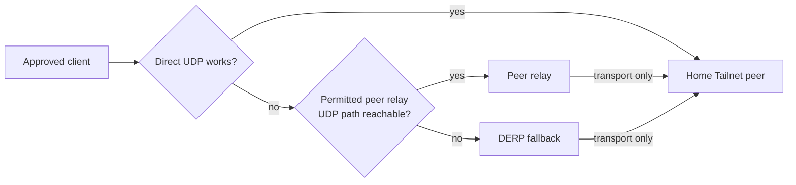

**English** · [简体中文](70-peer-relay.zh-CN.md)

# What can a peer relay do when direct transport is blocked?

You are travelling. The phone and the home Tailnet host both appear online, but
the connection stalls. It works after you move to another Wi-Fi network. The
problem may be whether the two
devices can establish a usable transport, even when access is authorized.
Direct transport, peer relay, and
DERP are different paths. Keep them separate before turning "the network took
another turn" into "the access policy changed."

Tailscale's
[device connectivity documentation](https://tailscale.com/docs/reference/device-connectivity)
describes direct, peer relay, and DERP as separate paths. When direct is
unavailable, a peer relay can forward through another device in the Tailnet. It
is still not an Internet exit and does not change the destination's
authorization.

## One concrete morning

You open an approved laptop in a hotel and try to reach a home file service.
Both the laptop and the service are online. The Tailnet tries direct transport,
but the hotel network blocks the UDP path between these peers. That does not
mean all UDP is blocked: a peer relay still needs its own reachable UDP port. Then:

- if a usable, permitted peer relay exists, the connection can continue
  through that relay;
- if one does not, the client may still try DERP;
- if the service does not permit your identity in the first place, changing
  transport will not make the login succeed.

"Direct failed" says only that the first transport was not established. It does
not prove that the destination is unreachable, and it does not mean DIRECT
should be enabled. `CLAIM-01`

## Where the relay sits in the path

The important part is the relay's position: it is a transport hop between peer
and service, not a new policy decision. It does not select a general proxy for
the client, change the Internet exit used for home traffic, or bypass Tailnet
policy or the service's own login. Even with the relay in the diagram, ask who
may use the relay and who may reach the service as separate questions.

A peer relay does not promise better speed. It can improve availability when
direct transport is impossible, or add latency. That is different from a
performance optimization. Tailscale's
[peer relay documentation](https://tailscale.com/docs/features/peer-relay)
describes trying an available peer relay before DERP and explicitly calls the
relay transport rather than an Internet exit.

## Prepare a relay, not a universal exit

Establish these boundaries before making a deployment decision:

| What to establish | Why it comes first |
| --- | --- |
| Version and role | On 2026-10-22, the official documentation says peer relay requires both peers and the relay to be version 1.86 or later. A deployment still needs readback from its actual installed version. |
| Whether the relay is permitted | Only an explicitly authorized device should take the role. An accessible UDP port and Tailnet configuration are prerequisites, not a public ingress. |
| Relay stability | It should remain online, be maintainable, and have an explanation for restarts and key changes. A VPS with a stable public position can help, but it still has upkeep. |
| Destination authorization | The service permits an identity or group of sources, not "traffic that used a relay." |
| Layered observation | Record direct, relay, and DERP paths separately. Looking only at a final page success loses the evidence needed to distinguish them. |

A VPS on the public Internet is often a relay candidate because it has a
relatively stable address and connectivity conditions. That does not make it a
router or automatically turn it into the exit for all traffic. It still needs a
minimal exposed surface: expose only the ports needed for its role, restrict
who may use them, and preserve an independent management path.

## What observations reject the wrong conclusion

**"The page failed, so the Tailnet ACL denied it."** First observe the direct
attempt and whether relay or DERP was selected, then inspect service
authentication. Transport failure and application denial are different layers.
A failed page does not prove an ACL denial, and a permitted ACL does not prove
transport reachability.

**"A relay lets a public network reach any private service."** A relay is not a
DIRECT allowlist and does not elevate authorization. Check both a successful
path for an approved identity and the failure of an unapproved identity or
neighboring destination.

**"The VPS is fast, so relay is necessarily faster."** Compare two transports to
the same destination during the same period, including completion time and
failure mode. A relay provides another path; it does not guarantee acceleration.

**"DERP is involved, so the relay did nothing."** The order depends on current
conditions. Configuring peer relay does not mean every connection uses it. It
becomes possible only when direct is unavailable and the relay is usable.
Version, grants, port reachability, and device state still need separate
confirmation.

## The VPS role: transport node, not a second control plane

Putting a VPS in a Tailnet is common, but decide which job it has:

- **Peer relay:** help peers establish another transport path;
- **Private ingress gateway:** use a dedicated identity for a named origin, as
  in [the VPS ingress guide](40-tailnet-vps-private-ingress.en.md);
- **General proxy exit:** change Internet egress, which needs separate policy
  and acceptance;
- **Subnet router:** advertise a specific LAN, as in
  [the travel-router guide](60-travel-router.en.md).

These roles may share a host, but identities and permitted responsibilities
still need separate bindings (`IDENT-03`). "It is a VPS" does not transfer
capability from one role to another. In particular, do not describe peer relay as DIRECT
or as a fallback for a general proxy. It solves transport between peers. Both
ends still need valid identities, the destination still needs an allow, and
ordinary Internet traffic does not change exit.

A separate VPS acting only as a peer relay does not compete for Mintie's local
routes or DNS. Compatibility matters when multiple tools manage routing, DNS,
or interception on the same host, network namespace, or traffic scope
(`ROUTE-01`). Draw the complete path and assign each hop and layer an owner.
For broader networking and proxy background, read
[Infra Field Guide: network and proxies](https://github.com/IndelibleVivi/infra-field-guide/blob/main/docs/07-network-and-proxies.md).

## The judgment left at the end

The only supported conclusion is that, under the current version,
authorization, ports, and device states, an approved relay can carry a
particular transport. It cannot establish service permission, the Internet
exit, long-term health, or "every client can connect." Version facts are dated
2026-10-22. This page provides no configuration commands and does not claim that
any relay or VPS is running.

Continue reading:

- [Cloudflare Mesh, Tailscale, and the OpenWrt boundary](80-mesh-and-openwrt.en.md)
  compares how different overlays define paths and device roles.
- [Case 7](50-worked-cases.en.md#prefix-failure-vs-redundancy) explains why a
  failed more-specific route does not fall through to a broader one.
- [Infra Field Guide: private access](https://github.com/IndelibleVivi/infra-field-guide/blob/main/docs/09-private-access.md)
  covers the surrounding work of managing remote machines.
