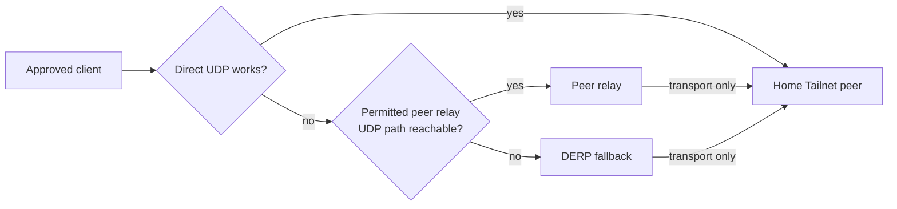

[English](70-peer-relay.en.md) · **简体中文**

# 直连被挡时，peer relay 能做什么

人在旅途中，手机和家里的 Tailnet 主机都显示在线，却一直连不上。换到另一个
Wi-Fi 后又能打开。这里的问题可能不在“是否有权访问”，而在两台设备能不能建立
一条可用的 transport。直连、peer relay 和 DERP 是三条不同的路；先分清它们，
才不会把“网络绕了一下”误写成“访问权限变了”。

Tailscale 的 [device connectivity 文档](https://tailscale.com/docs/reference/device-connectivity)
把 direct、peer relay 和 DERP 分开描述。direct 不可用时，peer relay 可以借助
Tailnet 里另一台设备转发；它仍然不是互联网出口，也不能改变目标端的权限。

## 一个具体的早晨

你在旅馆打开一台获准的笔记本，想访问家里的文件服务。笔记本与服务端都在线。
Tailnet 尝试 direct transport，但旅馆网络阻止了这对 peer 之间的 UDP 路径。
这不等于所有 UDP 都被封锁；peer relay 仍需要它自己的 UDP 端口可达。此时：

- 如果有可用、已获准的 peer relay，连接可以继续经过那台 relay；
- 如果没有，客户端仍可能尝试 DERP；
- 如果目标服务本来就不允许你的身份访问，换 transport 也不会让登录成功。

“直连失败”只说明第一条 transport 没建立，不说明 destination 不可达，也不说明
必须打开 DIRECT。`CLAIM-01`

## Relay 在路径中的位置

图中最重要的不是箭头数量，而是 relay 的位置：它在 transport 层，位于 peer 与
服务之间。它不替客户端选择 general proxy，不把家里的连接改从某个公共出口发出，
也不绕过 Tailnet policy 或服务自身的登录。把 relay 放在图中之后，仍然要分别
检查“谁获准使用 relay”“谁获准访问服务”。

peer relay 不保证更快。它可能改善无法直连时的可用性，也可能增加一跳延迟；这与
速度优化是两个目标。Tailscale 的
[peer relay 文档](https://tailscale.com/docs/features/peer-relay)说明它会在可用
时先尝试 peer relay，然后才轮到 DERP，并明确 relay 不是 Internet exit。

## 准备一台 relay，而不是准备一个万能出口

在写入任何部署决定前，至少确认这些边界：

| 要确认的事 | 为什么要先确认 |
| --- | --- |
| 版本与角色 | 官方文档在 2026-10-22 说明 peer relay 需要相关 peer 与 relay 达到 1.86 或更高；具体部署仍应以自己安装的版本和 readback 为准 |
| relay 是否被允许 | 只让明确授权的设备承担这个角色；可访问的 UDP 端口与 Tailnet 配置是必要条件，不是公开“入口” |
| relay 设备稳定性 | 它要长期在线、能接受维护、能解释重启和 key 变化；VPS 的稳定公网位置可能有用，但仍有维护成本 |
| 目标服务权限 | 服务允许的是某 identity 或某组来源，不是“经过 relay”本身 |
| 观测分层 | direct、relay、DERP 的路径要分别记录；只看最终页面成功会失去判断依据 |

一个位于公共网络的 VPS 常被拿来做 relay，因为它有相对稳定的地址和连接条件。
这并不使 VPS 成为路由器，也不自动让它成为所有流量的出口。VPS 仍要遵守最小
暴露面：只开放承担 relay 所需的端口，限制谁能使用，并保留独立的管理路径。

## 用什么观察推翻错误结论

**“页面打不开，所以 Tailnet ACL 拒绝了。”** 先看 direct 尝试、relay 或 DERP
的选择，再看服务认证。transport 失败与应用拒绝是不同层。页面失败不能证明
ACL 拒绝，ACL 通过也不能证明 transport 可达。

**“有了 relay，就能从公共网络访问任何私有服务。”** Relay 不是 DIRECT
allowlist，也不是权限提升。实际检查应同时包括获准身份的成功路径，以及一个未获准
身份或相邻目的地的失败路径。

**“VPS 性能好，所以走 relay 一定更快。”** 比较同一目的地、同一时段的两条
transport；记录完成时间与失败方式。relay 的职责是提供另一条路，不是承诺加速。

**“DERP 也在用，所以 relay 根本没有工作。”** 它们的先后顺序取决于当前条件。
配置了 peer relay 不等于每次都必须经过它；只有在 direct 不可用且 relay 可用时，
它才可能被选择。版本、授权、端口可达性、设备状态都要分别确认。

## VPS 的角色：transport 节点，不是第二个控制面

把 VPS 放进 Tailnet 是常见做法，但要先决定它到底承担什么：

- **Peer relay：** 帮助 peer 之间建立另一条 transport；
- **Private ingress gateway：** 使用专用身份访问某个明确 origin，见
  [VPS 专用入口](40-tailnet-vps-private-ingress.zh-CN.md)；
- **普通代理出口：** 改变 Internet egress，需要另一套 policy 与验收；
- **Subnet router：** 宣告一个具体 LAN，见
  [旅行路由器与 client-free 设备](60-travel-router.zh-CN.md)。

这些角色可以共置，但身份与允许的职责仍须分别绑定（`IDENT-03`），不能因为
“都是 VPS”就互相授予能力。尤其不要把 peer relay
写成 DIRECT 或通用 proxy 的 fallback：它只解决 peer 之间的 transport。源端和
目标端仍要拥有有效身份，目标仍要允许访问，普通 Internet 流量也不因此改变出口。

一台单独的 VPS 只做 peer relay，不会因此与 Mintie 争夺本机的 route 或 DNS。
真正需要兼容性检查的是同一 host、network namespace 或同一流量范围内，多个
工具同时接管 routing、DNS 或 interception（`ROUTE-01`）。先画出完整路径，
把每一跳与每一层的 owner 写清楚。需要更多网络与代理基础时，可以读
[Infra Field Guide：网络与代理](https://github.com/IndelibleVivi/infra-field-guide/blob/main/docs/07-network-and-proxies.md)。

## 最后留下的判断

peer relay 的结论只能是：在当前版本、授权、端口与设备状态下，某条 transport
是否可以由获准的 relay 转发。它不能推出服务权限、Internet 出口、长期健康或
“所有客户端都能连”。版本事实在本页标记为 2026-10-22；本页不提供配置命令，
也不声称任何 relay 或 VPS 已经实际运行。

继续读：

- [Cloudflare Mesh、Tailscale 与 OpenWrt 的边界](80-mesh-and-openwrt.zh-CN.md)
  比较不同 overlay 对路径与设备角色的定义。
- [案例 7](50-worked-cases.zh-CN.md#prefix-failure-vs-redundancy)解释为什么
  一条更具体的 route 失效时不会自动掉到较宽的 route。
- [Infra Field Guide：private access](https://github.com/IndelibleVivi/infra-field-guide/blob/main/docs/09-private-access.md)
  补充远端管理机器的背景。
