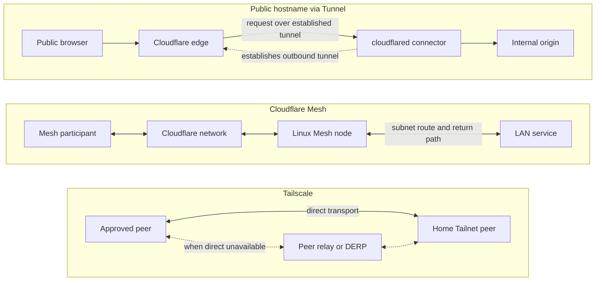

**English** · [简体中文](80-mesh-and-openwrt.zh-CN.md)

# Cloudflare Mesh, Tailscale, and OpenWrt: similar names, different layers

Three terms appear together: Mesh, Tailscale, and OpenWrt. All three can be
described as "connecting devices," but they do not solve the same problem at
the same layer. Cloudflare Mesh is peer connectivity carried by Cloudflare.
cloudflared Tunnel is an inbound service path established from an internal
connector. Tailscale is another overlay. OpenWrt is a router operating system
and package environment. Putting them in one device list can produce a tidy
screenshot while hiding ownership and return-path questions.

A common scene: a Mintie already owns transparent routing, DNS, and
fail-closed enforcement at home. You now want another site, or a remote worker
needs to reach an old NAS. The useful question is not "which one should I
install?" It is "who owns routing, who terminates DNS, who maintains membership,
and how does the service reply?"

The version and capability facts below are dated **2026-10-22**. Products change;
a deployment still has to inspect what it actually installed and activated.
This article supplies no OpenWrt, Cloudflare, or Tailscale configuration script.

## Draw three different kinds of connection in the right place

Cloudflare's [Mesh concepts](https://developers.cloudflare.com/mesh/concepts/)
describe Mesh as the successor concept to WARP Connector: participants
communicate through Cloudflare rather than establishing a direct device-to-device
connection. That is not the same thing as cloudflared Tunnel. A Tunnel connects
inbound access to an internal service through a connector initiated from inside
the network; Mesh is a network among participating nodes. Keeping the arrows
separate prevents "both get through NAT" from replacing a role description.

A Tailscale subnet router is another role again. It advertises a LAN reachable
through the Tailnet. A peer relay handles transport. An exit node changes the
ordinary Internet exit. Calling all of them "Mesh" leaves no way to tell whether
a connection changed DNS, general Internet egress, or service permission.

## OpenWrt: a package exists, but that is not a validated router recipe

The OpenWrt packages repository contains source for a Tailscale package. On
2026-10-22, the master branch's
[package Makefile](https://raw.githubusercontent.com/openwrt/packages/master/net/tailscale/Makefile)
and [procd/UCI init file](https://raw.githubusercontent.com/openwrt/packages/master/net/tailscale/files/tailscale.init)
are evidence that the source exists. Master is not a stable version installed on
any particular device, and it is not runtime readback from Mintie. The presence
of a package answers "this source exists," not "this router has safely taken
over the existing interception, DNS, and nftables policy."

On 2026-10-22, Cloudflare's [Mesh Linux guide](https://developers.cloudflare.com/mesh/guides/run-mesh-on-linux/)
lists supported Debian, Ubuntu,
Fedora, and RHEL AMD64/ARM64 systems; it does not list OpenWrt as an officially
supported native distribution. That does not prove a port can never work. It
means an unlisted system cannot be presented as a verified appliance recipe.
The [Mesh platform page](https://developers.cloudflare.com/mesh/platform/) marks
it beta, includes Free, and requires MASQUE. Hostname, IPv6 CIDR, and HA features
are unavailable in WireGuard mode. Check the actual account and node types
before deployment.

The OpenWrt [cloudflared package](https://raw.githubusercontent.com/openwrt/packages/master/net/cloudflared/Makefile)
is a Tunnel client package, not a Mesh node. The diagram shows a public hostname:
the connector establishes an outbound tunnel to Cloudflare, then browser
requests travel over that established tunnel to the origin. Tunnel also supports
private IP routes; this does not make it the same bidirectional participation
model as Mesh or prove that a subnet return path has been configured.

If Mesh is genuinely needed near OpenWrt, a source-level candidate is a supported
Linux Mesh node as a sidecar on the same LAN, owning Mesh participation and its
routes while OpenWrt/Mintie retains its router policy. Each device has its own
routing table; assign forwarding and DNS responsibilities hop by hop.
Cloudflare's [routes documentation](https://developers.cloudflare.com/mesh/features/routes/)
requires both outbound and return subnet traffic to traverse an appropriate
Mesh node. This sidecar remains an architecture candidate until LAN return
routing, same-host dnsmasq/interception coexistence, installation, and path
evidence have been verified.

## Why "just add one client" can change the system

Cloudflare's [best practices](https://developers.cloudflare.com/mesh/best-practices/)
warn that Mesh's Traffic-and-DNS mode competes with DNS services on the same host,
and that other VPN managers on the same host or network namespace can compete
for routes covering the same traffic. Cloudflared and Mesh
coexistence also needs supported Split Tunnels configuration. These are ownership
questions, not installation trivia.

Tailscale's
[4via6 subnet documentation](https://tailscale.com/docs/features/subnet-routers/4via6-subnets)
handles overlapping IPv4 sites by giving site A and site B different site
identities in an IPv6 mapping, even when both retain the same IPv4 range. It does
not renumber every old device or decide which router owns which route. Reusing a
site ID and mapping on several routers can provide redundancy for the same site;
reaching a different site requires a different site identity. See
[case 6](50-worked-cases.en.md#4via6-site-identity) for that distinction.

Overlapping control on the same host, namespace, or traffic scope can quietly
create a second DNS or route owner. A separate Mesh node does not create a
conflict merely by existing. Ask which event changes a DNS answer, which changes
packet routing, which determines the return path, and who can prove the result.

## GL.iNet, beta, and the gap around "officially listed"

On 2026-10-22, GL.iNet still labels its
[Tailscale integration](https://docs.gl-inet.com/router/en/4/interface_guide/tailscale/)
as beta and names models including Beryl 7 GL-MT3600BE. Version 4.9 introduces
IP Masquerading, in which LAN sources can appear as the router's Tailscale IP,
plus Run Exit Node and a rename from remote access to Advertise LAN/WAN Subnets.
A renamed control does not turn the integration into a validated Mintie
configuration.

Separate any UI claim into three questions: did the device install and activate
the relevant version; does that version really provide the required subnet,
SNAT, and DNS behavior; and is it compatible with Mintie's existing routing
owner? Vendor support answers part of the first question. The third needs its own
architecture decision and negative tests.

## Conclusions supportable today

1. **Cloudflare Mesh** carries peer connectivity through Cloudflare and is not
   the same ingress model as cloudflared Tunnel.
2. **Tailscale** subnet routes, peer relays, exit nodes, and private ingress
   have different jobs. One role does not silently supply another.
3. **OpenWrt** has official source packages for Tailscale and cloudflared, but
   master is not installed-state evidence, and Cloudflare's supported Mesh Linux
   list does not name OpenWrt as a native distribution.
4. **Mintie** and other nodes can divide work hop by hop. Overlapping routing/DNS
   management on the same host, namespace, or traffic scope needs an ownership
   check.

These are source-level boundaries, not a field test of a router, account, or real
path. Before migrating, obtain an explicit architecture decision and authority,
then verify source, installation, activation, and path evidence separately.
`ROUTE-01` `CLAIM-01`

Continue reading:

- [Carry a travel router, or put a client on every device?](60-travel-router.en.md)
  starts from client-free LAN access and return paths.
- [What can a peer relay do when direct transport is blocked?](70-peer-relay.en.md)
  separates transport from authorization.
- [The VPS ingress guide](40-tailnet-vps-private-ingress.en.md) covers canonical
  HTTPS origins and dedicated gateways.
- [Infra Field Guide: network and proxies](https://github.com/IndelibleVivi/infra-field-guide/blob/main/docs/07-network-and-proxies.md)
  and [private access](https://github.com/IndelibleVivi/infra-field-guide/blob/main/docs/09-private-access.md)
  provide background.
