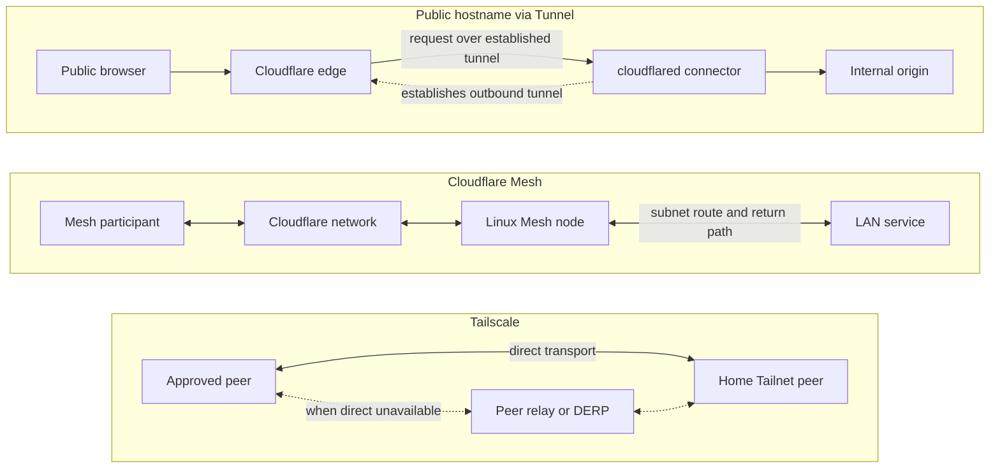

[English](80-mesh-and-openwrt.en.md) · **简体中文**

# Cloudflare Mesh、Tailscale 与 OpenWrt：名字相近，层不相同

首页上出现三个词：Mesh、Tailscale、OpenWrt。它们都可能被描述成“把几台设备
连起来”，但解决的问题不在同一层。Cloudflare Mesh 是一套由 Cloudflare 承载的
peer connectivity；cloudflared Tunnel 是从内部服务建立出去的入站入口；
Tailscale 是另一个 overlay；OpenWrt 则是路由器操作系统与软件包环境。把它们
放在一张设备列表里，会得到很整齐的截图，也会藏掉真正的 ownership 与 return
path。

一个常见场景是：家里已经有一台 Mintie 负责 transparent routing、DNS 和
fail-closed enforcement，现在想在另一处加一台设备，或者让旧 NAS 能被远端的
worker 访问。正确的问题不是“再装哪一个”，而是“谁拥有路由、谁终止 DNS、谁
维护成员身份、服务端如何回复”。

以下版本与能力事实按 **2026-10-22** 记录；产品会变化，部署仍要查看自己实际
安装和激活的版本。本文不提供 OpenWrt、Cloudflare 或 Tailscale 配置脚本。

## 先把三种“连接”画在正确位置

Cloudflare 的 [Mesh concepts](https://developers.cloudflare.com/mesh/concepts/)
说明，Mesh 沿用 WARP Connector 的概念，让参与者通过 Cloudflare 双向通信，
而不是两台设备直接建立连接。它和 cloudflared Tunnel 不是同一个东西：Tunnel
把对内部服务的入站访问接到一个由内部发起的 connector；Mesh 是一组参与节点
之间的网络。图中把这两条路分开，是为了避免用“都能穿透 NAT”替代角色说明。

Tailscale 的 subnet router 又是另一个角色。它宣告可被 Tailnet 访问的 LAN；
peer relay 只处理 transport；exit node 才改变一般互联网出口。把它们统称为
“Mesh”会让读者无法判断这次连接是否改变了 DNS、互联网出口或服务权限。

## OpenWrt：有软件包，不等于经过验证的路由器接法

OpenWrt 官方 packages 中有 Tailscale 包的源码；截至 2026-10-22，master 分支
的 [package Makefile](https://raw.githubusercontent.com/openwrt/packages/master/net/tailscale/Makefile)
与 [procd/UCI init 文件](https://raw.githubusercontent.com/openwrt/packages/master/net/tailscale/files/tailscale.init)
可以作为发布源码的证据。但 master 不是任何设备上已安装的稳定版本，也不是
Mintie 的 runtime readback。包存在只能回答“有源码”，不能回答“这台路由器已经
安全接管现有 interception、DNS 与 nftables policy”。

Cloudflare 的 [Mesh Linux 指南](https://developers.cloudflare.com/mesh/guides/run-mesh-on-linux/)
在 2026-10-22 列出 Debian、Ubuntu、Fedora、RHEL
的 AMD64/ARM64 支持范围，没有把 OpenWrt 列为官方支持的 native distro。这并不
证明任何移植在技术上永远不可能；它只说明不能把“非列出的系统”写成已验证的
appliance 配方。[Mesh 平台页](https://developers.cloudflare.com/mesh/platform/)同时标注 beta，
支持范围包含 Free，并要求 MASQUE；hostname、IPv6 CIDR 与 HA 等能力不能沿用
WireGuard 模式。部署前仍需按实际账号与节点类型核对。

OpenWrt 的 [cloudflared package](https://raw.githubusercontent.com/openwrt/packages/master/net/cloudflared/Makefile)
是 Tunnel client 的打包证据，不是 Mesh node。上图只画 public hostname 场景：
connector 向 Cloudflare 建立出站 tunnel，浏览器请求再沿已建立的 tunnel 到 origin。
Tunnel 也支持 private IP routes；这不等于 Mesh 的双向参与模型，更不证明
subnet return path 已经配置。

因此，若确实需要在 OpenWrt 附近使用 Mesh，较稳妥的 source-level 候选是：把
受支持的 Linux Mesh node 作为同一 LAN 的 sidecar，由它承担 Mesh 参与与路由，
OpenWrt/Mintie 继续拥有既定的路由器 policy。两台设备各有自己的路由表，
逐跳写清 forwarding 与 DNS 责任。Cloudflare 的 [routes 文档](https://developers.cloudflare.com/mesh/features/routes/)
要求 subnet 的去程与回程均经过合适的 Mesh node。这个 sidecar 仍只是架构候选：
要验证 LAN return route、同宿主 dnsmasq 与 interception 的共存，以及实际安装
与 path evidence，才能成为部署步骤。

## 为什么“再加一个客户端”可能改变已有系统

Cloudflare 的 [best practices](https://developers.cloudflare.com/mesh/best-practices/)
提醒：Mesh 的 Traffic-and-DNS 模式会与同宿主 DNS 服务竞争，同一 host 或 network namespace 内的其他 VPN routing
manager 也可能争夺相同流量的路由。Cloudflared 与 Mesh 共存还需要受支持的 Split Tunnels
配置。这不是安装细节，而是 ownership 问题。

同样，Tailscale 的 [4via6 subnet 文档](https://tailscale.com/docs/features/subnet-routers/4via6-subnets)
处理的是重叠 IPv4 site 的身份：site A 与 site B 可以使用同样的 IPv4 范围，
通过不同 site ID 得到不同的 IPv6 mapping。它不重编号每台旧设备，也不自动决定
哪一个 router 应该拥有哪条 route。若两家都用相同的 site ID 和 mapping，多个
router 可以作为同一 site 的 redundancy；若想访问另一个 site，就必须选择另一个
site 身份。这类规则更适合在 [案例 6](50-worked-cases.zh-CN.md#4via6-site-identity)
里慢慢分辨。

在同一 host、namespace 或流量范围内叠加控制时，新软件可能悄悄成为第二个
DNS 或 route owner。另一台独立 Mesh node 的存在本身不构成冲突。要问的是：
哪一个事件改变 DNS answer，哪一个改变 packet route，哪一个决定 return path，
最后由谁证明这些状态真的生效？

## GL.iNet、beta 与“官方列出”之间的空隙

GL.iNet 的 [Tailscale 页面](https://docs.gl-inet.com/router/en/4/interface_guide/tailscale/)
在 2026-10-22 仍把集成标为 beta，并列出 Beryl 7 GL-MT3600BE 等型号。4.9 版本
引入 IP Masquerading（LAN 来源可能显示为路由器的 Tailscale IP）、Run Exit
Node，以及把 remote access 改名为 Advertise LAN/WAN Subnets。名称变了，语义
并没有因此变成 Mintie 的已验证配置。

任何 UI 支持都应被拆成三类问题：设备是否安装并激活了对应版本；该版本是否真的
提供所需 subnet/SNAT/DNS 行为；它与 Mintie 现有 routing owner 是否兼容。
厂商支持只能回答第一层的一部分。第三层需要自己的 architecture decision 与
negative tests。

## 今天可以写下的结论

1. **Cloudflare Mesh** 以 Cloudflare 作为 peer connectivity 的承载层，和
   cloudflared Tunnel 不是同一个 ingress 模型。
2. **Tailscale** 的 subnet route、peer relay、exit node 与 private ingress 各有
   不同职责；一个角色不会自动提供另一个角色。
3. **OpenWrt** 有 Tailscale 与 cloudflared 的官方源码包，但当前 master 不是
   installed 事实，且官方 Mesh Linux 列表没有把 OpenWrt 列为 native supported
   distro。
4. **Mintie** 与其他节点可以逐跳分工；在相同 host、namespace 或流量范围内
   叠加 routing/DNS 管理时，需要重新核对 ownership。

这些是 source-level 的边界，不是对某台路由器、某个账号或某条真实路径的现场
测试。要决定是否迁移，先取得明确的架构选择与授权，再分别验证 source、安装、
激活和 path evidence。`ROUTE-01` `CLAIM-01`

继续读：

- [带一台旅行路由器，还是给每台设备装客户端？](60-travel-router.zh-CN.md)
  从 client-free 设备的 LAN 与 return path 出发。
- [直连被挡时，peer relay 能做什么](70-peer-relay.zh-CN.md) 区分 transport
  与访问权限。
- [VPS 专用入口](40-tailnet-vps-private-ingress.zh-CN.md) 讲 canonical HTTPS
  origin 与专用 gateway。
- [Infra Field Guide：网络与代理](https://github.com/IndelibleVivi/infra-field-guide/blob/main/docs/07-network-and-proxies.md)
  与 [private access](https://github.com/IndelibleVivi/infra-field-guide/blob/main/docs/09-private-access.md)
  提供背景材料。
